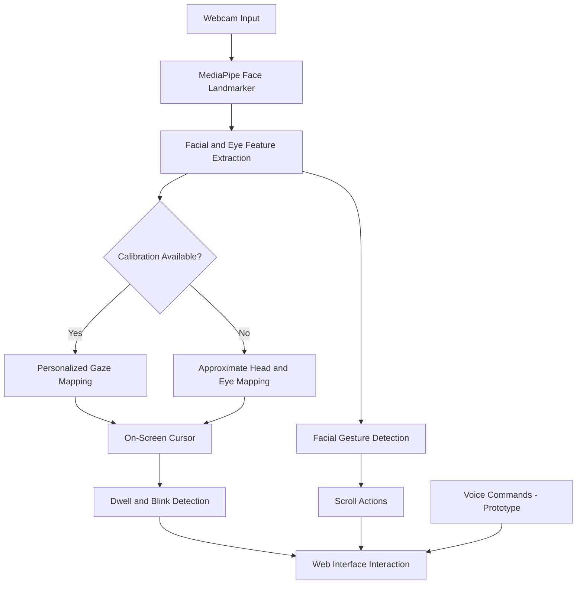

# 👁️ EyeNav — Eye-Controlled Computer Access

### ♿ Navigate the web with your eyes. Interact hands-free.
## 📸 Project Screenshots

<p align="center">
  
  <br/>
  <em>📊 EyeNav dashboard</em>
</p>

<p align="center">
  
  <br/>
  <em>🎯 Eye-tracking calibration</em>
</p>

<p align="center">
  
  <br/>
  <em>👁️ Hands-free interaction demo</em>
</p>

## 🚀 Live Demo
🌐 **Try EyeNav:** [Open Live Website](https://eye-nav-eye-controlled-computer-acc.vercel.app/#/demo)

**EyeNav** is a webcam-based accessibility project that explores hands-free web navigation using eye tracking, facial gestures, and voice commands. Built with React, MediaPipe, and modern web technologies, it aims to make digital interaction more accessible for people who find traditional mouse or keyboard input difficult.

<p align="center">
  
  
  
  
</p>

<p align="center">
  <a href="https://github.com/PratikshaRaskar/EyeNav---Eye-Controlled-Computer-Access">
    
  </a>
</p>

---

## 🌟 About the Project

Traditional computer interfaces depend heavily on physical input devices such as a mouse and keyboard. For people with limited hand or finger mobility, these interactions can create accessibility barriers.

EyeNav explores an alternative approach: using a standard webcam to estimate eye-related movements, detect facial gestures, and support selected voice commands within a web application.

🎯 **Our mission:** Explore affordable, camera-based assistive interaction that makes web navigation more inclusive.

## ✨ Key Features

| Feature | Description | Status |
|---|---|---|
| 👁️ Eye Tracking | Detects facial and eye landmarks using MediaPipe | Working |
| 🎯 Gaze Calibration | Uses a nine-point calibration process to personalize cursor mapping | Working |
| 🖱️ Gaze-Based Cursor | Moves an on-screen cursor within the application | Working |
| ⏱️ Dwell-to-Click | Activates supported elements after a configurable gaze duration | Working |
| 😉 Blink-to-Click | A deliberate long blink triggers a click | Working |
| 😉 Wink Gestures | Left wink for clicking and right wink for right-click actions | Working |
| 🙂 Facial Gestures | Mouth opening scrolls down; eyebrow raising scrolls up | Working |
| 🎙️ Voice Commands | Supports a limited set of navigation and interaction commands | Prototype |
| ⚙️ Personalization | Adjustable sensitivity, responsiveness, and gesture thresholds | Partial / prototype |
| 📊 Live Dashboard | Displays tracking status, gesture signals, and performance metrics | Working |
| ♿ Accessibility Settings | Includes options such as high contrast, large text, and reduced motion | Working |

*Feature status describes the current project implementation, not a guarantee of compatibility with every device or browser.*

## 🛠️ Technology Stack

<p align="center">
  
</p>

- **Frontend:** React 18, JavaScript, HTML5, CSS3
- **Build tool:** Vite
- **Computer vision:** MediaPipe Tasks Vision — Face Landmarker
- **Styling:** Tailwind CSS
- **Animations:** Framer Motion
- **Icons:** Lucide React
- **Voice interaction:** Web Speech API
- **Browser APIs:** Webcam access, video processing, DOM events and local storage

## ⚙️ How It Works



### 🔍 Processing Pipeline

1. **Camera initialization:** The browser requests permission to access the webcam.
2. **Face detection:** MediaPipe processes video frames and estimates facial landmarks and blendshape scores.
3. **Calibration:** The user follows calibration targets to improve gaze-to-screen mapping.
4. **Cursor positioning:** The application estimates cursor coordinates and smooths movement using a responsiveness setting.
5. **Gesture recognition:** Blink, wink, mouth-opening, and eyebrow-raising signals are evaluated against configurable thresholds.
6. **Interaction:** Supported web elements respond to gaze dwell, deliberate blinks, winks, facial gestures, or supported voice commands.

## 🚀 Getting Started

### Prerequisites

- Node.js and npm
- A webcam
- A modern browser, preferably Google Chrome or Microsoft Edge
- An internet connection for the initial installation and external model assets

### 1. Clone the repository

```bash
git clone https://github.com/PratikshaRaskar/EyeNav---Eye-Controlled-Computer-Access.git
```

### 2. Open the project folder

```bash
cd EyeNav---Eye-Controlled-Computer-Access
```

### 3. Install dependencies

```bash
npm install
```

### 4. Start the development server

```bash
npm run dev
```

### 5. Open the application

Open the local URL displayed in your terminal, usually:

```text
http://localhost:5173
```

Allow webcam access when prompted, start tracking, and follow the calibration instructions.

### Production build

To verify that the application can be built for deployment:

```bash
npm run build
```

To preview the production build locally:

```bash
npm run preview
```

## 🧪 Try the Demo

Once the application is running:

1. Open the **Calibration** page and complete the calibration targets.
2. Navigate to **Demo** and start webcam tracking.
3. Look toward a practice button to move the cursor.
4. Hold your gaze over a supported element to try dwell-to-click.
5. Try a deliberate long blink or a wink to activate supported click actions.
6. Open your mouth to scroll down or raise your eyebrows to scroll up.
7. Enable voice control to test the supported voice commands.

💡 **Tip:** Use steady lighting, keep your face visible, and position the webcam near eye level for better tracking.

## 🗂️ Project Structure

```text
EyeNav---Eye-Controlled-Computer-Access/
├── public/                  # Static assets, if present
├── src/
│   ├── components/
│   │   ├── Nav.jsx
│   │   └── ui.jsx
│   ├── context/
│   │   └── Tracker.jsx
│   ├── lib/
│   │   └── gaze.js
│   ├── pages/
│   │   ├── Home.jsx
│   │   ├── Dashboard.jsx
│   │   ├── Calibration.jsx
│   │   ├── Demo.jsx
│   │   ├── Features.jsx
│   │   └── About.jsx
│   ├── App.jsx
│   ├── main.jsx
│   └── index.css
├── index.html
├── package.json
├── vite.config.js
├── tailwind.config.js
├── postcss.config.js
└── README.md
```

## 🔐 Privacy and Accessibility

- Webcam access requires the user's permission.
- Video frames are processed in the browser by the application's tracking pipeline and are not uploaded by this application.
- The face model is downloaded from an external model host.
- Browser speech recognition may send audio to a cloud service, depending on browser implementation.
- Camera availability, lighting, facial movement, and individual differences can affect tracking reliability.

**Accessibility note:** EyeNav is an experimental project, not a certified assistive technology device.

## ⚠️ Current Limitations

- Tracking accuracy can vary with lighting, camera quality, head position, and calibration.
- Voice control supports a limited command set and is currently a prototype.
- A browser-based application cannot directly control the operating-system cursor or provide unrestricted interaction with other desktop applications.
- System-wide computer access would require a separate native companion application or additional operating-system integration.
- The project has not been established as a replacement for commercial eye-tracking hardware.

## 🔮 Future Enhancements

- [ ] Improve gaze estimation and calibration accuracy.
- [ ] Expand voice-command coverage and error handling.
- [ ] Add more personalization and robust gesture recognition.
- [ ] Improve cross-browser compatibility.
- [ ] Conduct usability testing with people who have different accessibility needs.
- [ ] Explore a native companion application for system-wide control.
- [ ] Add demonstration screenshots and a hosted live preview.

## 👩‍💻 Author

**Pratiksha Raskar**

- GitHub: [@PratikshaRaskar](https://github.com/PratikshaRaskar)
- Project: [EyeNav — Eye-Controlled Computer Access](https://github.com/PratikshaRaskar/EyeNav---Eye-Controlled-Computer-Access)

## 🤝 Contributions

Suggestions, bug reports, and accessibility-focused feedback are welcome. Open an issue to discuss improvements before submitting significant changes.

## 📄 License

No open-source license has been specified yet. Add a license file if you decide to permit reuse and redistribution.

---

<p align="center">
  <b>👁️ Look. Interact. Access.</b><br/>
  Building toward a more accessible digital experience.
</p>
